# Entity-Relationship Diagram

## 1. Introduction

This document presents the logical Entity-Relationship Diagram (ERD) for the Smart Hostel Maintenance & Complaint Prioritization Platform.

The diagram represents all 22 entities and their relationships based on the approved entity identification and relationship documentation.

## 2. Entity-Relationship Diagram

```mermaid
erDiagram
    ROLE ||--o{ APP_USER : assigns
    HOSTEL ||--o{ ROOM : contains

    APP_USER ||--o| STUDENT_PROFILE : has
    APP_USER ||--o| MAINTENANCE_STAFF_PROFILE : has

    APP_USER ||--o{ WARDEN_ASSIGNMENT : receives
    HOSTEL ||--o{ WARDEN_ASSIGNMENT : has

    STUDENT_PROFILE ||--o{ STUDENT_ROOM_HISTORY : has
    HOSTEL ||--o{ STUDENT_ROOM_HISTORY : records
    ROOM ||--o{ STUDENT_ROOM_HISTORY : assigned_in

    MAINTENANCE_STAFF_PROFILE ||--o{ STAFF_SPECIALIZATION : has
    MAINTENANCE_SPECIALIZATION ||--o{ STAFF_SPECIALIZATION : includes

    MAINTENANCE_STAFF_PROFILE ||--o{ STAFF_HOSTEL_ASSIGNMENT : receives
    HOSTEL ||--o{ STAFF_HOSTEL_ASSIGNMENT : assigns

    STUDENT_PROFILE ||--o{ COMPLAINT : submits
    HOSTEL ||--o{ COMPLAINT : receives
    ROOM o|--o{ COMPLAINT : concerns
    COMPLAINT_CATEGORY ||--o{ COMPLAINT : classifies

    COMPLAINT ||--o{ COMPLAINT_ASSIGNMENT : has
    MAINTENANCE_STAFF_PROFILE ||--o{ COMPLAINT_ASSIGNMENT : handles
    APP_USER ||--o{ COMPLAINT_ASSIGNMENT : assigns

    COMPLAINT ||--o{ COMPLAINT_EVENT : records
    APP_USER ||--o{ COMPLAINT_EVENT : performs

    PRIORITY_POLICY ||--o{ PRIORITY_POLICY_FACTOR : contains
    COMPLAINT ||--o{ COMPLAINT_PRIORITY_SNAPSHOT : has
    PRIORITY_POLICY ||--o{ COMPLAINT_PRIORITY_SNAPSHOT : used_for

    EMBEDDING_MODEL ||--o{ COMPLAINT_EMBEDDING_REFERENCE : generates
    COMPLAINT ||--o{ COMPLAINT_EMBEDDING_REFERENCE : has

    COMPLAINT ||--o| FEEDBACK : receives
    STUDENT_PROFILE ||--o{ FEEDBACK : submits

    APP_USER ||--o{ AUDIT_LOG : generates

    ROLE {
        int role_id PK
    }
    APP_USER {
        int user_id PK
        int role_id FK
    }
    HOSTEL {
        int hostel_id PK
    }
    ROOM {
        int room_id PK
        int hostel_id FK
    }
    STUDENT_PROFILE {
        int student_id PK
        int user_id FK
    }
    MAINTENANCE_STAFF_PROFILE {
        int staff_id PK
        int user_id FK
    }
    WARDEN_ASSIGNMENT {
        int warden_assignment_id PK
        int user_id FK
        int hostel_id FK
    }
    STUDENT_ROOM_HISTORY {
        int room_history_id PK
        int student_id FK
        int hostel_id FK
        int room_id FK
    }
    COMPLAINT_CATEGORY {
        int category_id PK
    }
    MAINTENANCE_SPECIALIZATION {
        int specialization_id PK
    }
    STAFF_SPECIALIZATION {
        int staff_specialization_id PK
        int staff_id FK
        int specialization_id FK
    }
    STAFF_HOSTEL_ASSIGNMENT {
        int staff_hostel_assignment_id PK
        int staff_id FK
        int hostel_id FK
    }
    COMPLAINT {
        int complaint_id PK
        int student_id FK
        int hostel_id FK
        int room_id FK
        int category_id FK
    }
    COMPLAINT_ASSIGNMENT {
        int assignment_id PK
        int complaint_id FK
        int staff_id FK
        int assigned_by FK
    }
    COMPLAINT_EVENT {
        int event_id PK
        int complaint_id FK
        int performed_by FK
    }
    PRIORITY_POLICY {
        int policy_id PK
    }
    PRIORITY_POLICY_FACTOR {
        int factor_id PK
        int policy_id FK
    }
    COMPLAINT_PRIORITY_SNAPSHOT {
        int snapshot_id PK
        int complaint_id FK
        int policy_id FK
    }
    EMBEDDING_MODEL {
        int model_id PK
    }
    COMPLAINT_EMBEDDING_REFERENCE {
        int embedding_reference_id PK
        int complaint_id FK
        int model_id FK
    }
    FEEDBACK {
        int feedback_id PK
        int complaint_id FK
        int student_id FK
    }
    AUDIT_LOG {
        int audit_id PK
        int user_id FK
    }
```

## 3. Design Notes

1. The platform contains 22 entities.
2. Junction entities represent many-to-many relationships.
3. Complaint assignment and event entities preserve operational history.
4. Priority snapshots preserve historical prioritization decisions.
5. Complaint embedding references connect MySQL records to vectors stored in Qdrant.
6. Feedback is limited to one record per complaint in the initial design.
7. A complaint's room reference is optional for common-area complaints.
8. Primary and foreign key definitions shown here are preliminary and will be finalized in the relational schema.

## 4. Conclusion

The ER diagram provides the logical structure for the platform. It will be used as the basis for relational schema design, normalization, and MySQL implementation.